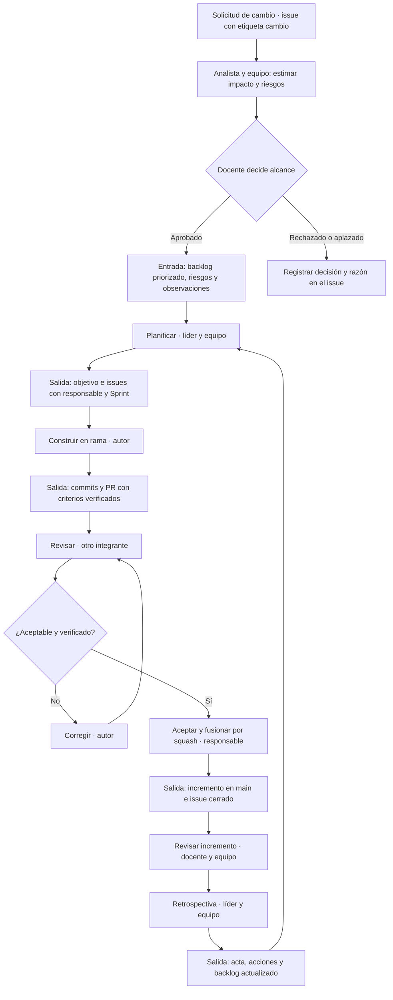
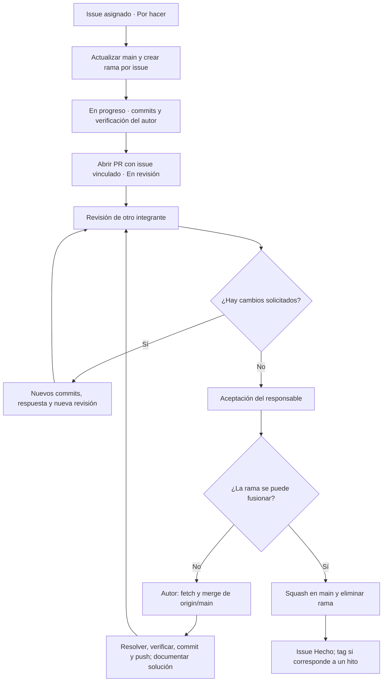

# Proceso del equipo — SymptoLeaf-AI

Grupo 3 · NRC 36848 · Construcción y Evolución de Software

Equipo: Mesias Mariscal (@AMVMesias), Denise Rea (@DeniseRea) y Jordan Guaman (@GuamanJordan).

Este documento reúne las partes A, B, C y E del laboratorio. Consolida el Taller 1, los requisitos y el borrador del informe compartido. Su contenido se somete a revisión mediante el PR de modelado; una planificación no demuestra por sí sola su ejecución. Las evidencias corresponden a los issues, commits, revisiones y actas reales.

## A. Metodología y flujo del proceso

### A.1 Elección y aplicación

El Taller 1 eligió provisionalmente el modelo incremental: obtuvo 63 puntos, frente a 46 de cascada y 55 de la alternativa ágil. El proyecto se organiza en ocho iteraciones de dos semanas durante 16 semanas. Cada incremento permite comprobar una parte del flujo Android: fotografía, clasificación local, comprensión del resultado, asistencia e historial. La revisión al cierre permite ajustar las siguientes tareas según los resultados y la disponibilidad de la docente-cliente. Se conserva la decisión del Taller 1; el término sprint designa estas iteraciones de trabajo.

El product backlog se mantiene como historias vinculadas a requisitos y casos de uso. Al planificar se acuerdan objetivo, responsables y campo Sprint en GitHub Projects. Cada autor desarrolla en una rama por issue y abre un PR; otra persona revisa, el responsable acepta y se integra por squash. El incremento se presenta a la docente y la retrospectiva produce acciones para el siguiente sprint.

### A.2 Actividades, entradas y salidas

| Actividad | Entrada | Salida | Responsable |
|---|---|---|---|
| Priorizar y planificar | Backlog, riesgos, observaciones y capacidad | Objetivo, issues seleccionados, responsables y Sprint | Líder y equipo; docente prioriza alcance |
| Construir y documentar | Issue asignado con criterios | Rama, commits, documentos o código y PR | Autor, en su rol de desarrollador |
| Revisar y corregir | PR, criterios y verificaciones | Comentarios, correcciones y nueva revisión | Revisor y autor |
| Aceptar e integrar | PR revisado, hilos resueltos y verificaciones | Squash en main e issue cerrado cuando cumple el alcance | Responsable de aceptación y fusión |
| Validar el incremento | Incremento integrado y evidencia | Aceptación u observaciones registradas | Docente-cliente y equipo |
| Mejorar el proceso | Resultados, bloqueos y experiencia | Acta y dos o tres acciones con responsable, fecha y estado | Líder y equipo |

Un cambio de alcance debe indicar motivo, historias/RF/CU afectados, esfuerzo y efecto sobre los hitos. La docente-cliente decide su incorporación y el equipo actualiza backlog y Sprint. Si altera el compromiso del sprint en curso, se registra qué trabajo se sustituye; no se añade silenciosamente.

### A.3 Eventos

Las duraciones siguientes son las previstas en el borrador del equipo; su realización se registra por separado.

| Evento | Cuándo | Duración prevista | Participantes | Evidencia en GitHub |
|---|---|---|---|---|
| Planificación | Inicio de cada sprint de dos semanas | 20 min | Equipo; docente para prioridades y dudas de alcance | Objetivo, issues asignados y campo Sprint |
| Seguimiento | Inicio de cada clase | 5 min | Equipo | Board actualizado y bloqueos comentados en issues |
| Revisión | Cierre del sprint | 10 min | Docente y equipo | Incremento demostrado y aceptación u observaciones registradas |
| Retrospectiva | Cierre del sprint | 15 min | Equipo, facilitado por el líder | `docs/proceso/retros/sprint-N.md` y acciones de mejora |

El plan del Taller 1 también contempla seguimiento semanal. Si no hay clase durante una semana, se mantiene ese seguimiento breve y se dejan los acuerdos en los issues.

### A.4 Relación con los hitos

| Sprint | Semanas | Enfoque de referencia del Taller 1 | Hito |
|---|---|---|---|
| 1 | 1–2 | Alcance, usuarios, categorías, herramientas, modelos y servicios | Preparación y requisitos priorizados |
| 2 | 3–4 | Entidades, navegación, permisos, cuenta, cámara y galería | Primer flujo con pruebas de errores |
| 3 | 5–6 | Clasificación local, validación y presentación del resultado | v0.1.0 en semana 6 |
| 4 | 7–8 | Historial asociado a cada usuario | Guardar, consultar y borrar; privacidad entre cuentas |
| 5 | 9–10 | Orientación, chat, errores y preparación de integración continua | Versión candidata a v1.0 |
| 6 | 11–12 | Entrega integrada y observaciones | v1.0.0 en semana 11; revisión en semana 12 |
| 7 | 13–14 | Mejora priorizada con usuarios | Mejora y regresión verificadas |
| 8 | 15–16 | Correcciones, evaluación y documentación | v1.1.0 en semana 16 |

Se normalizan como etiquetas semánticas `v1.0.0` y `v1.1.0` los hitos denominados v1.0 y v1.1 en el Taller 1. Las fechas calendario de la semana 1 y de entrega siguen por confirmar. Esta secuencia es un plan, no una declaración de funcionalidades terminadas ni el objetivo ya acordado del Sprint 2.

## B. Roles y responsabilidades

### B.1 Roles del Sprint 1

| Rol | Persona | Responsabilidades concretas |
|---|---|---|
| Product Owner y cliente | Ing. Nancy Betancourt, según el borrador del equipo | Priorizar, decidir sobre alcance y aceptar u observar el incremento |
| Líder | Mesias Mariscal | Facilitar planificación, revisión y retrospectiva; mantener el proceso y coordinar acciones |
| Analista | Denise Rea | Redactar historias y criterios; mantener trazabilidad entre funciones, RF, CU y backlog |
| Calidad y DevOps | Jordan Guaman | Administrar repositorio y Project, verificar reglas de integración, calidad y versionado |
| Desarrollador | Los tres integrantes | Producir cambios en ramas propias, verificar el trabajo y revisar aportes de otra persona |

En el reparto operativo actualizado, Denise revisó el PR de colaboración #5 y Jordan lo fusionó. Jordan revisa, acepta y fusiona los PR de requisitos de Denise. Para el PR de modelado de Mesias, Denise revisa y comenta; Jordan aprueba y fusiona. La retrospectiva de Mesias la revisa y fusiona Jordan. Esta distribución sustituye la instrucción anterior que asignaba a Mesias la aprobación del PR #5 y a Denise su fusión.

### B.2 Matriz RACI del Sprint 1

R: ejecuta; A: aprueba o responde por la actividad; C: consultado; I: informado. Cada fila tiene exactamente una A; A/R combina ambas funciones. En la columna Desarrollador actúa el autor o revisor designado, nunca el autor aprobando su propio PR.

| Actividad | Docente | Líder | Analista | Calidad y DevOps | Desarrollador |
|---|---|---|---|---|---|
| Priorizar el backlog | A | C | R | I | I |
| Redactar historias y criterios | C | C | A/R | C | C |
| Planificar el sprint | C | A | R | C | R |
| Crear y asignar issues en GitHub | I | C | C | A/R | I |
| Elaborar y publicar cambios en una rama y PR | I | I | C | C | A/R |
| Revisar el contenido de un PR de Mesias | I | C | A/R | C | I |
| Revisar y aceptar el PR de requisitos de Denise | I | I | C | A/R | I |
| Revisar y aprobar el PR de colaboración de Jordan | I | C | A/R | I | I |
| Fusionar PR aceptados, incluido el de colaboración | I | I | C | A/R | I |
| Mantener tablero y estados | I | A | C | R | R |
| Evaluar impacto de cambios de alcance | A | C | R | C | C |
| Aceptar el incremento del sprint | A/R | C | I | C | I |
| Facilitar y documentar la retrospectiva | I | A/R | C | C | C |
| Etiquetar un hito verificado | I | C | I | A/R | I |

La aceptación de un PR comprueba su calidad e integración; la aceptación del producto y las decisiones de alcance corresponden a la docente. Para el PR propio de Jordan, la aprobación de Denise mantiene la revisión independiente antes de la fusión.

### B.3 Plan de rotación de los ocho sprints

| Sprint | Semanas | Líder | Analista | Calidad y DevOps |
|---|---|---|---|---|
| 1 | 1–2 | Mesias | Denise | Jordan |
| 2 | 3–4 | Denise | Jordan | Mesias |
| 3 | 5–6 | Jordan | Mesias | Denise |
| 4 | 7–8 | Mesias | Denise | Jordan |
| 5 | 9–10 | Denise | Jordan | Mesias |
| 6 | 11–12 | Jordan | Mesias | Denise |
| 7 | 13–14 | Mesias | Denise | Jordan |
| 8 | 15–16 | Denise | Jordan | Mesias |

Todos desarrollan y revisan durante los ocho sprints. La rotación académica no cambia automáticamente la propiedad del repositorio ni los permisos: Jordan conserva la administración, y las operaciones del responsable de Calidad se coordinan con él. En cada planificación se designa un revisor distinto del autor y se confirma quién acepta y fusiona cada PR.

## C. Artefactos y definición de terminado

### C.1 Catálogo

Las ubicaciones del catálogo describen dónde debe mantenerse cada artefacto. La existencia de una ubicación prevista no implica que su contenido o configuración ya estén completos.

| Artefacto | Propósito | Formato o plantilla | Ubicación | Responsable | Actualización |
|---|---|---|---|---|---|
| Product backlog | Priorizar alcance y conservar criterios | Issues con plantilla `historia.md`; referencia `historias.md` | Issues y Project; `docs/02-requisitos/historias.md` | Analista; Jordan publica en Sprint 1 | Priorización o cambio de alcance aprobado |
| Sprint backlog | Registrar compromiso del sprint | Issues reales con responsable, Prioridad, Talla y Sprint | Project y sus issues | Equipo; Jordan administra | Planificación y seguimiento |
| Incremento | Reunir cambios verificados | Commits integrados; etiquetas en hitos | Rama `main` y Tags | Calidad y autores | Cada PR integrado y cierre de sprint |
| Acta y matriz del Taller 1 | Mantener objetivos y elección del modelo | Documento de inicio | `docs/01-inicio/Taller-1-Arranque-Proyecto.docx` | Analista y equipo | Cambio aprobado de objetivos o método |
| Requisitos e historias | Especificar comportamiento y aceptación | PDF y Markdown | `docs/02-requisitos/` | Analista y autores | Cambios aprobados en historias, RF o criterios |
| Casos de uso y modelo editable | Mantener trazabilidad y diseño | PDF y `.drawio` | `docs/03-modelado/` | Mesias como autor; analista consulta | Cambio aprobado de requisitos o modelado |
| Definición de terminado | Verificar cuándo cerrar un trabajo | Lista de verificación | `CONTRIBUTING.md`, `.github/pull_request_template.md` y este documento | Calidad | Acuerdo de cambio del proceso |
| Proceso del equipo | Describir roles, eventos y reglas | Markdown y Mermaid | `docs/proceso/PROCESO.md` | Líder | Cambio del proceso mediante PR |
| Registro de riesgos | Mantener riesgos, respuesta y responsable | Tabla A.3 del Taller 1 | `docs/01-inicio/Taller-1-Arranque-Proyecto.docx` | Líder coordina; cada responsable actualiza | Inicio y cierre del sprint o nuevo riesgo |
| Actas de retrospectiva | Registrar mejoras y seguimiento | Markdown con acciones, responsable, fecha y estado | `docs/proceso/retros/sprint-N.md` | Líder y equipo | Cierre de cada sprint; seguimiento de acciones |
| Evidencia de revisión | Demostrar revisión y correcciones | PR, comentarios, revisiones y commits | Pull requests del repositorio | Autor, revisor y responsable de aceptación | Cada revisión, corrección y fusión |

La Tarea 3 recibida ya está en `docs/02-requisitos/`; se incorpora una copia identificada en `docs/03-modelado/` para cumplir la estructura del laboratorio y conservar los enlaces publicados por Denise. Si cambia su contenido, deben actualizarse ambas copias en el mismo PR o consolidarse y corregirse todos los enlaces.

Al preparar este documento, los PR #5 y #6 están fusionados. El proceso y el editable forman parte del aporte de modelado en preparación. El acta de retrospectiva y la planificación acordada de Sprint 2 se completarán con información real del equipo. La configuración y los campos del Project se verifican directamente en GitHub; esta tabla no los certifica.

### C.2 Definición de terminado

Se conservan las condiciones publicadas en `CONTRIBUTING.md` y la plantilla de PR:

- [ ] El PR enlaza un issue con `Closes #N` y cumple sus criterios de aceptación.
- [ ] La rama, los commits y el título del PR siguen las convenciones.
- [ ] La documentación afectada está actualizada, cuando aplica.
- [ ] Desde la semana 5, se ejecutaron y pasaron las pruebas aplicables.
- [ ] Otro integrante dejó un comentario y el responsable de aceptación aprobó el PR después de resolver los hilos.
- [ ] El cambio entró por squash y el issue vinculado quedó en Hecho.

En cambios documentales se revisan rutas, enlaces, legibilidad, consistencia y apertura de los archivos editables; se indica en el PR qué se verificó. Las metas de calidad del producto del Taller 1 se evalúan en sus entregas: cobertura de al menos 70 % de las clases seleccionadas, flujo completado sin ayuda por 4 de 5 participantes y evaluación piloto de al menos 60 imágenes con objetivo de 80 % de exactitud. Estas metas no se presentan como resultados ya alcanzados.

### C.3 Regla de actualización documental

Los documentos del curso se modifican mediante PR revisado. El autor indica qué cambió y qué historias, RF o CU se afectan; actualiza los enlaces del README cuando corresponde. Los acuerdos, aprobaciones, fechas y resultados de prueba se registran únicamente cuando suceden. El alcance publicable de este aporte se limita a la Tarea 3, su diagrama editable y la documentación del proceso del equipo. El código y el historial del proyecto base no forman parte de este PR; cualquier publicación posterior de esos materiales requiere definir su alcance por separado.

## E. Flujo de ramas y convenciones

### E.1 Comparación para este proyecto

| Criterio | Git Flow | GitHub Flow | Trunk-based |
|---|---|---|---|
| Equipo de tres integrantes | Añade coordinación de ramas persistentes `main` y `develop` | Una rama corta por issue facilita repartir aportes | Exige cambios muy pequeños e integración frecuente al tronco |
| Frecuencia de integración | Agrupa integración y preparación por releases | Integra cada PR aceptado | Favorece integración diaria o varias veces al día |
| Versiones e hitos | Ramas de release y hotfix, además de tags | Tags sobre `main` en semanas 6, 11 y 16 | Tags sobre tronco estable; puede requerir ocultar funciones incompletas |
| Conflictos | Ramas largas pueden acumular divergencias | Se reducen actualizando ramas cortas y revisando cada issue | Se reducen mediante lotes pequeños e integración muy frecuente |
| Adecuación al laboratorio | Mayor complejidad para tres autores y un producto académico | Elegido: hace visibles issue, revisión, corrección y fusión | Viable con disciplina de integración y verificaciones frecuentes |

### E.2 Estrategia elegida

Se adopta GitHub Flow con ramas por issue. Para tres integrantes permite trabajar en paralelo y revisar un aporte delimitado antes de integrarlo. Los PR conservan trazabilidad entre criterios, revisiones y correcciones. El squash deja un commit de integración por PR, y los tags identifican los hitos del curso sin mantener ramas de release adicionales. Se procura que las ramas duren lo mínimo necesario para completar y revisar el issue.

### E.3 Convenciones

| Elemento | Regla | Ejemplo |
|---|---|---|
| Rama | `tipo/número-descripción`, en minúsculas y con guiones; tipos `docs`, `feature`, `fix` | `docs/3-modelado-y-proceso` |
| Commit | `tipo: descripción en presente (#issue)`; tipos `docs`, `feat`, `fix`, `test`, `chore` | `docs: incorpora modelado y proceso del equipo (#3)` |
| Título de PR | Tipo y descripción concreta del aporte | `docs: incorpora modelado y proceso del equipo` |
| Cuerpo de PR | Plantilla vigente, motivo, archivos, verificación y referencia al issue | `Closes #3` cuando el PR cubre el alcance del issue |
| Revisión | Revisor distinto del autor, comentarios atendidos y aprobación antes de integrar | Denise revisa modelado; Jordan acepta y fusiona |
| Fusión | Squash and merge y eliminación de rama tras integrar | Un commit del PR en `main` |
| Versiones | Etiquetas semánticas sobre un commit verificado de `main` | `v0.1.0`, `v1.0.0`, `v1.1.0` |
| Documentos | Cambios por PR revisado, con enlaces y fuentes actualizados | Modelo y proceso enlazados desde el README |

Las ramas ya utilizadas se citan con sus nombres reales aunque difieran de un ejemplo de la convención. No se renombran ni se reescriben commits anteriores para aparentar que siguieron otra secuencia.

### E.4 Flujo de integración

### E.5 Resolución y evidencia de conflictos

Si GitHub informa de un conflicto, el autor guarda el aviso antes de resolverlo, ejecuta `git fetch origin` y `git merge origin/main` en su rama y revisa cada archivo marcado. En el README conserva los enlaces válidos de todos los aportes y elimina los marcadores de conflicto. Después ejecuta `git add README.md` y `git diff --cached --check`, crea el commit, lo sube y explica la solución mediante `gh pr comment`. Si hay más archivos afectados, también se revisan y agregan antes del commit. El revisor comprueba el resultado actualizado.

El plan inicial preveía que Denise y Mesias partieran del mismo `main` antes de integrar requisitos. En la ejecución observada, el PR #6 de Denise se fusionó antes de crear la rama de Mesias; esta parte del `main` actualizado. El PR #6 contiene una resolución de conflictos realizada por Denise. Esa evidencia se atribuye a ella y no se presenta como una resolución de Mesias. Según la coordinación actualizada del equipo, el informe utilizará el conflicto real del PR #6 como evidencia grupal; no se requiere recrearlo en la rama de Mesias.

## Fuentes y pendientes de validación

- Taller 1: `docs/01-inicio/Taller-1-Arranque-Proyecto.docx` y planificación del proyecto.
- Tarea 2 y backlog: `docs/02-requisitos/Tarea-2-Requisitos.pdf` y `historias.md`.
- Tarea 3 y editable: `docs/03-modelado/`.
- [Borrador del informe del equipo](https://docs.google.com/document/d/12PHGobasPabb1DHIKRCy9dmgEPLaNXGpOcLCX4HUic8/edit).
- [PR #5 de colaboración](https://github.com/GuamanJordan/symptoleaf-ai-lab2/pull/5) y [PR #6 de requisitos](https://github.com/GuamanJordan/symptoleaf-ai-lab2/pull/6): evidencia real de revisión y fusión.
- Falta confirmar fecha de entrega, fecha de inicio de semana 1 y cuenta GitHub de la docente. La aceptación de este proceso, la retrospectiva y el objetivo de Sprint 2 deben quedar respaldados por sus revisiones y acuerdos reales.

Se utilizó asistencia de ChatGPT/Codex para preparar este borrador a partir de las fuentes del equipo. La revisión de contenido y los acuerdos corresponden a los integrantes.
